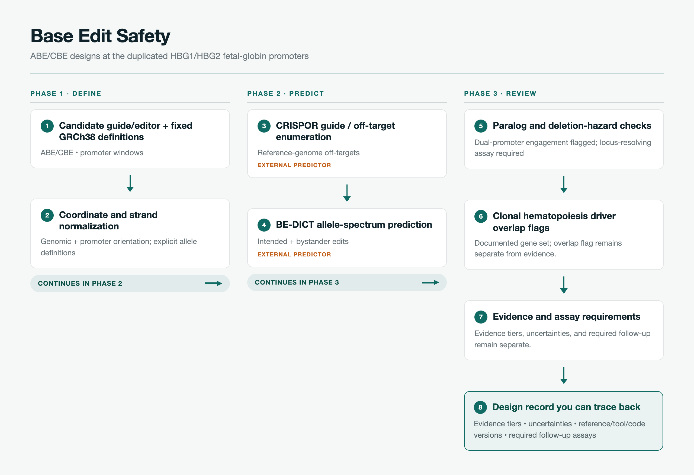

# Base Edit Safety

Base Edit Safety helps researchers compare CRISPR base-editing designs at the duplicated
**HBG1/HBG2** fetal-globin promoters. It brings predicted edits, off-target candidates,
duplicated-locus checks, evidence sources, and suggested follow-up assays into one record.

## System design



## What it does

- predicts intended and bystander edits for ABE and CBE designs;
- keeps off-target candidates separate from experimentally measured findings;
- checks whether a guide may engage both HBG1 and HBG2;
- flags overlap with a small, documented set of genes linked to clonal hematopoiesis;
- records reference coordinates, tool versions, and where each result came from; and
- produces a compact design record for review.

## Install

Python 3.10 or newer is required.

```bash
python3 -m venv .venv
source .venv/bin/activate
python -m pip install --upgrade pip
python -m pip install -e ".[test]"
python -m pytest -q
```

BE-DICT and CRISPOR are installed separately. See the [setup guide](docs/setup.md) for
configuration.

## Run an analysis

After configuring CRISPOR and BE-DICT, enumerate candidates across the fixed GRCh38 promoter
windows:

```bash
python -m base_edit_safety.pipeline.enumerate_guides
python -m base_edit_safety.pipeline.design_records
```

Results are written under `data/outputs/` and include the inputs, reference build, tool versions,
and evidence labels used for the run. The [example walkthrough](docs/example-run.md) explains the
output flow.

## Current scope

The first release focuses on ABE and CBE designs in fixed HBG1/HBG2 promoter windows on GRCh38.
The [validation summary](docs/validation.md) describes the checks that have been completed. Source
tables, paper-derived records, and validation run data stay in the private research workspace.

## Documentation

- [Setup and configuration](docs/setup.md)
- [Workflow overview](docs/architecture.md)
- [Coordinate conventions](docs/coordinates.md)
- [Example run](docs/example-run.md)
- [Local data layout](data/README.md)
- [Validation summary](docs/validation.md)

## License

The project code is licensed under the [Apache License 2.0](LICENSE). External tools, models,
publications, and datasets retain their own licenses and terms. Publisher tables and artifacts
derived from their rows are outside this repository.
